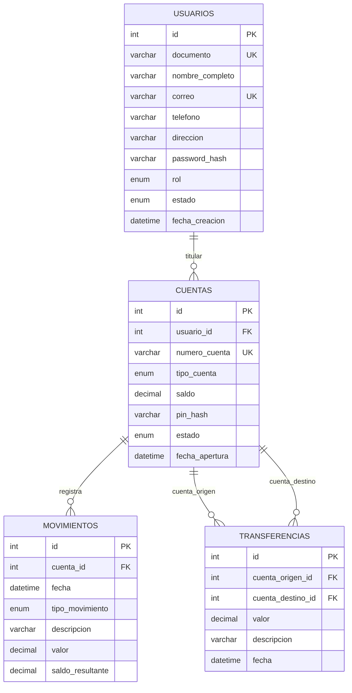

# 🏦 NovaBank — Simulador Bancario Web

Aplicación web integral que simula las operaciones de una entidad bancaria real (**NovaBank**), compuesta por tres módulos conectados en tiempo real sobre una única base de datos **MySQL**:

1. **Sucursal Virtual Personas (Módulo de Cliente)**
2. **Consola Central de Administración (Módulo Administrativo del Banco)**
3. **Red de Cajeros NovaATM (Módulo de Cajero Automático Virtual)**

---

## 📋 1. Descripción del Proyecto

El sistema permite gestionar usuarios, cuentas bancarias de ahorros y corrientes, retiros desde cajero automático mediante número de cuenta y PIN, transferencias transaccionales entre cuentas, consignaciones administrativas y auditoría completa de movimientos financieros.

Cualquier operación realizada desde cualquiera de los tres canales actualiza inmediatamente los saldos y movimientos en MySQL mediante **transacciones SQL (`BEGIN`, `FOR UPDATE`, `COMMIT`, `ROLLBACK`)**, reflejándose al instante en los demás módulos.

---

## 👥 2. Integrantes

* **David / Brian Cruz Naranjo** — Desarrollo Full Stack (Backend Node.js/Express, Base de Datos MySQL y Frontend NovaBank)

---

## 🛠️ 3. Tecnologías Utilizadas

* **Backend (Obligatorio):**
  * **Node.js**
  * **Express.js**
  * Paquetes complementarios de seguridad y persistencia: `mysql2` (conexión y transacciones MySQL), `bcryptjs` (encriptación de contraseñas y PINs), `express-session` (manejo de sesiones y roles), `dotenv` (variables de entorno).
* **Base de Datos (Obligatoria):**
  * **MySQL** (Motor relacional InnoDB con llaves foráneas y restricciones `CHECK`).
* **Frontend:**
  * **HTML5**
  * **CSS3**
  * **JavaScript (ES6+ / Fetch API)**
  * **Bootstrap 5.3** + **Bootstrap Icons**

---

## 🏗️ 4. Arquitectura del Proyecto (Separación Backend / Frontend en 4 Capas)

El proyecto implementa una división clara entre `backend/`, `frontend/` y `database/`. El backend sigue la arquitectura en capas (**Modelos → Servicios [Cocinero] → Controladores [Mesero] → Rutas [Menú] → Cliente**):

```text
simulador-bancario/
├── database/
│   ├── database.sql               # Script SQL con tablas, relaciones y datos iniciales de prueba
│   └── diagrama-bd.md             # Diagrama Entidad-Relación de la base de datos
│
├── backend/                       # Servidor Node.js + Express.js
│   ├── config/
│   │   └── db.js                  # Pool de conexión a MySQL mediante variables de entorno (.env)
│   ├── middlewares/
│   │   └── auth.middleware.js     # Guardias de sesión, rol (CLIENTE, ADMIN, CAJERO) y estado ACTIVO
│   ├── models/                    # 1. MODELOS (Consultas SQL a cada tabla)
│   │   ├── usuarios.model.js
│   │   ├── cuentas.model.js
│   │   ├── movimientos.model.js
│   │   └── transferencias.model.js
│   ├── services/                  # 2. SERVICIOS - "El Cocinero" (Reglas de negocio y transacciones)
│   │   ├── auth.service.js
│   │   ├── cliente.service.js
│   │   ├── admin.service.js
│   │   └── cajero.service.js
│   ├── controllers/               # 3. CONTROLADORES - "El Mesero" (Recibe req y responde res.json)
│   │   ├── auth.controller.js
│   │   ├── cliente.controller.js
│   │   ├── admin.controller.js
│   │   └── cajero.controller.js
│   ├── routes/                    # 4. RUTAS - "El Menú" (Endpoints de la API REST)
│   │   ├── auth.routes.js
│   │   ├── cliente.routes.js
│   │   ├── admin.routes.js
│   │   └── cajero.routes.js
│   └── app.js                     # Punto de entrada del servidor Express
│
├── frontend/                      # 5. CLIENTE (Interfaz Web de NovaBank)
│   ├── index.html                 # Portal comercial público de NovaBank
│   ├── cliente/
│   │   ├── login.html             # Login de Sucursal Virtual Personas
│   │   └── dashboard.html         # Panel de Banca Virtual del Cliente
│   ├── admin/
│   │   ├── index.html             # Redirección de ruta privada /admin
│   │   ├── login.html             # Intranet Corporativa (Login de Funcionarios)
│   │   └── dashboard.html         # Consola Central de Administración
│   ├── cajero/
│   │   └── index.html             # Cajero Automático Virtual (NovaATM) con Pinpad en pantalla
│   ├── css/
│   │   └── styles.css             # Sistema de estilos de NovaBank
│   └── js/
│       ├── cliente.js
│       ├── admin.js
│       └── cajero.js
│
├── .env.example                   # Plantilla de variables de entorno
├── .gitignore                     # Exclusión de node_modules y .env
├── package.json                   # Dependencias y scripts de ejecución
└── README.md                      # Documentación general del proyecto
```

---

## 🗄️ 5. Diagrama de la Base de Datos



---

## ⚙️ 6. Requisitos para Ejecutar el Proyecto

* **Node.js** v18 o superior (con `npm`).
* **MySQL Server** v8.0+ o **XAMPP / MariaDB** activo en el puerto `3306`.
* **Git**.

---

## 🚀 7. Instrucciones de Instalación y Configuración de la Base de Datos

1. **Clonar el repositorio:**
   ```bash
   git clone https://github.com/Davidcr07/simulador_bancario.git
   cd simulador_bancario
   ```

2. **Instalar las dependencias de Node.js:**
   ```bash
   npm install
   ```

3. **Configurar la Base de Datos MySQL:**
   * Enciende el servicio de **MySQL** (por ejemplo, en XAMPP o MySQL Server).
   * Importa el archivo `database/database.sql` desde **phpMyAdmin**, **MySQL Workbench** o por terminal:
     ```bash
     mysql -u root -p < database/database.sql
     ```

4. **Configurar las variables de entorno (`.env`):**
   * Copia el archivo de ejemplo `.env.example` a `.env`:
     ```bash
     cp .env.example .env
     ```
   * Verifica las credenciales de tu MySQL en `.env`:
     ```env
     PORT=3000
     DB_HOST=localhost
     DB_PORT=3306
     DB_USER=root
     DB_PASSWORD=
     DB_NAME=simulador_bancario
     SESSION_SECRET=simulador_bancario_secreto_seguro_2026
     ```

---

## ▶️ 8. Forma de Ejecutar el Sistema

Inicia el servidor con:

```bash
npm start
```

Una vez iniciado, accede desde tu navegador a las siguientes rutas:

* **Portal Público del Banco (NovaBank):** `http://localhost:3000`
* **Módulo 1 — Sucursal Virtual Personas (Clientes):** `http://localhost:3000/cliente/login.html`
* **Módulo 2 — Consola Administrativa (Ruta Privada de Funcionarios):** `http://localhost:3000/admin`
* **Módulo 3 — Cajero Automático Virtual (NovaATM):** `http://localhost:3000/cajero/index.html`

---

## 🔑 9. Usuarios y Cuentas de Prueba

Todas las contraseñas y PINs están almacenados en la base de datos encriptados con `bcryptjs`. Para tus pruebas y demostración utiliza las siguientes credenciales:

| Rol | Nombre | Correo Electrónico | Cédula / Documento | Contraseña Web | Número de Cuenta | Tipo | PIN Cajero | Saldo Inicial | Estado |
| :--- | :--- | :--- | :--- | :--- | :--- | :--- | :--- | :--- | :--- |
| **ADMIN** | Administrador General | `admin@banco.com` | `1000000001` | `Admin123*` | — | — | — | — | `ACTIVO` |
| **CLIENTE** | Juan Pérez | `juan@correo.com` | `1000000002` | `Cliente123*` | `1001000001` | `AHORROS` | `1234` | `$1.000.000` | `ACTIVO` |
| **CLIENTE** | María Gómez | `maria@correo.com` | `1000000003` | `Cliente123*` | `1001000002` | `AHORROS` | `5678` | `$2.500.000` | `ACTIVO` |
| **CLIENTE** | Carlos Rodríguez | `carlos@correo.com` | `1000000004` | `Cliente123*` | `1001000003` | `CORRIENTE` | `9012` | `$450.000` | `BLOQUEADO` |

*(Puedes iniciar sesión en la Banca Virtual o en la Consola Administrativa ingresando tanto el **Correo Electrónico** como el número de **Cédula / Documento**).*

---

## ✨ 10. Principales Funcionalidades

* **Sucursal Virtual Personas (Cliente):**
  * Inicio y cierre de sesión seguro.
  * Consulta de saldo disponible, número y tipo de cuenta.
  * Historial de movimientos con filtro por tipo de operación (Fecha, Tipo, Descripción, Valor y Saldo Resultante).
  * Transferencias en línea hacia otras cuentas registradas con comprobante digital y doble registro contable.
  * Actualización de datos de contacto del perfil (protegiendo saldo, número de cuenta, rol y estado).
  * Cambio de contraseña con validación de clave actual.
* **Consola Central de Administración (Banco):**
  * Acceso independiente por ruta corporativa (`/admin`).
  * Dashboard con indicadores en tiempo real: Total de clientes, Clientes/Cuentas activas, Clientes bloqueados y Suma total de saldos.
  * Creación de nuevos clientes con apertura automática de cuenta bancaria, PIN encriptado y saldo inicial.
  * Directorio y buscador de clientes en tiempo real, vista de ficha detallada con movimientos, edición de cliente y cambio de estado (`ACTIVO`, `INACTIVO`, `BLOQUEADO`).
  * Consulta general de cuentas bancarias, realización de consignaciones y auditoría del historial general de movimientos del banco.
* **Cajero Automático Virtual (NovaATM):**
  * Identificación mediante Número de Cuenta y PIN con soporte para teclado físico y **Teclado Numérico en Pantalla (Pinpad)**.
  * Consulta de saldo disponible.
  * Retiros de efectivo con montos rápidos o valor personalizado, validaciones de negocio y tirilla de comprobante impreso.
  * Consulta de últimos movimientos y cierre seguro de operación.
