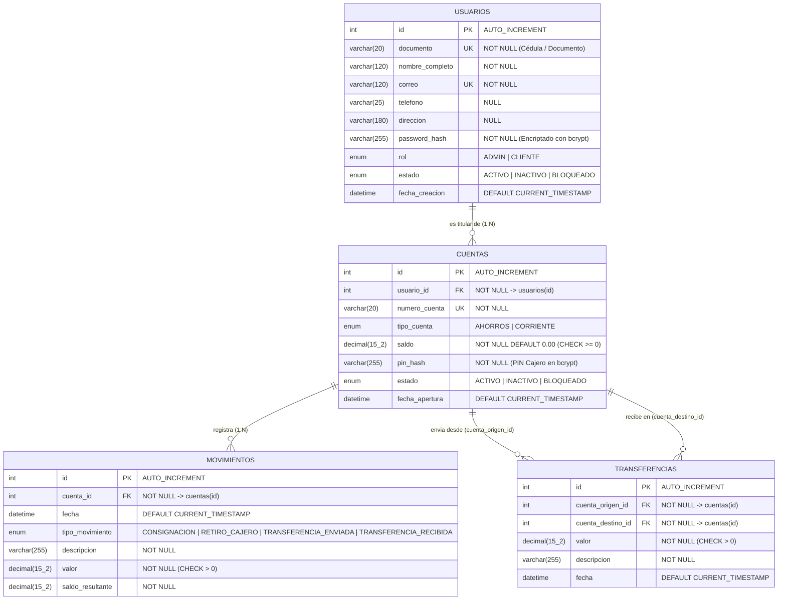

# Diagrama Entidad-Relación de la Base de Datos (`simulador_bancario`)

Este documento contiene el diseño relacional de la base de datos MySQL del sistema **NovaBank — Simulador Bancario Web**, cumpliendo con los requisitos de las Secciones 13 y 16 del documento del proyecto.

---

## 1. Diagrama Entidad-Relación (ER)

---

## 2. Descripción de Tablas, Llaves y Restricciones

| Tabla | Llave Primaria (PK) | Llaves Foráneas (FK) | Restricciones de Integridad y Reglas de Negocio |
| :--- | :--- | :--- | :--- |
| **`usuarios`** | `id` | — | `documento` (`UNIQUE`), `correo` (`UNIQUE`), `password_hash` (`NOT NULL`), `rol` (`ADMIN`, `CLIENTE`), `estado` (`ACTIVO`, `INACTIVO`, `BLOQUEADO`). |
| **`cuentas`** | `id` | `usuario_id` → `usuarios(id)` (`ON DELETE RESTRICT`) | `numero_cuenta` (`UNIQUE`), `chk_saldo_no_negativo` (`CHECK (saldo >= 0)`), `pin_hash` (`NOT NULL`), `estado` (`ACTIVO`, `INACTIVO`, `BLOQUEADO`). |
| **`movimientos`** | `id` | `cuenta_id` → `cuentas(id)` (`ON DELETE RESTRICT`) | `chk_valor_movimiento_positivo` (`CHECK (valor > 0)`), inmutabilidad de movimientos financieros. |
| **`transferencias`** | `id` | `cuenta_origen_id` → `cuentas(id)` `cuenta_destino_id` → `cuentas(id)` | `chk_valor_transferencia_positivo` (`CHECK (valor > 0)`), `chk_cuentas_distintas` (`CHECK (cuenta_origen_id <> cuenta_destino_id)`). |
